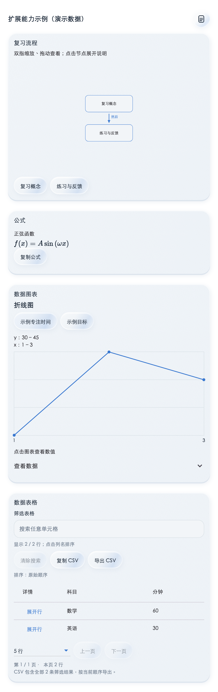

# Orialis

把待办、项目、日程和 AI 助手放在一起的日常事务工具。先在本机记录和安排，需要跨设备使用时再连接自己的服务；接入 Hermes 后，可以在聊天中整理信息、查看图表，并确认添加日程。

[下载 Android 最新版](https://github.com/J-X-C-Z/Orialis/releases/latest) · [部署自己的服务](docs/deployment.md) · [1.3.0 更新内容](docs/releases/1.3.0.md)

## 可以用它做什么

- **安排今天的事**：查看当天安排和到期待办，用重要／紧急分类整理任务，完成后直接勾选。
- **跟进项目**：把任务关联到项目，管理项目状态、目标、截止日期和里程碑。
- **管理日历和课表**：查看、编辑日程；接入助手后，可让它整理课表并按你的授权导入。
- **和自己的 AI 助手聊天**：选择已连接的 Hermes 设备，发送问题、图片或文档，保留会话和回复。
- **直接阅读结构化答案**：原生展示图表、表格、公式、步骤、方案对照和代码。日程提案可以先编辑标题、时间、地点和备注，确认后再保存。
- **本地记录、多设备同步**：未登录也能使用本机功能；连接同一服务器并登录同一账号后同步数据。高性能模式提供静态磨砂与缓存光影，减少实时模糊开销。

日程卡片显示出来时还没有创建日程。你明确确认后，客户端才会保存到本机并进入同步队列；本机已保存、待同步和同步失败会分别显示。

查看原生回复卡片示例（演示数据）

## 下载与平台

| 平台 | 如何使用 |
| --- | --- |
| Android | 在 [GitHub Releases](https://github.com/J-X-C-Z/Orialis/releases/latest) 下载 APK。目前正式版为 **1.3.0（37）**，支持 Android 7.0 及以上的 arm64 设备，附 SHA256SUMS 校验文件。 |
| macOS / Windows | 提供 Flutter 桌面源码，按 [客户端构建指南](mobile/README.md) 自行构建。当前 1.3.0 Release 未附桌面安装包。 |
| 浏览器 | 提供可自托管的 Web 客户端，包含任务、项目、日程和基础聊天；按 [Web 部署说明](docs/deployment.md#可选部署-web-客户端) 配置。 |

Android 也可以在 **我的 → 软件更新** 中检查 GitHub 最新正式版，下载后按系统提示确认安装。

## 第一次使用

1. 安装并打开应用，先在“事件”中添加待办，或在“日历”中安排时间。本机使用不要求先部署服务或登录。
2. 需要同步时，在 **我的 → 服务器** 填入你自己部署或管理员提供的 HTTPS 服务地址。
3. 点击“我的”顶部的 **未登录**，注册或登录账户。其他设备使用同一服务地址和账户，再检查同步状态。
4. 需要 AI 聊天时，由你或管理员按 [Hermes 接入步骤](docs/deployment.md#可选接入-hermes-助手) 配置助手，然后在聊天中选择在线设备。

## 部署自己的 Orialis

完整步骤见 **[自托管部署指南](docs/deployment.md)**，包括：

- 在 Linux 上构建和运行服务端，配置数据库与附件目录。
- 使用 systemd、Nginx 和 HTTPS 提供自己的访问地址。
- 让手机连接服务、注册账户，并可选接入 Hermes。
- 部署 Web 客户端，以及备份、升级、回滚和常见故障处理。

任务、项目和日历同步只需要 Orialis 服务端。AI 聊天另外需要运行 Hermes 并配置模型；模型服务、API 账号和费用由部署者自行选择和承担。

## 常见问题

**不连接服务器能用吗？**

可以先使用本机待办、项目和日历。跨设备同步及在线助手需要相应服务和网络连接。

**为什么聊天设备显示离线？**

Orialis 服务端运行并不代表助手已连接。还需要 Hermes 网关在线、设备 ID 与客户端匹配，并正确配置设备 token 和账号归属；见 [部署指南](docs/deployment.md#可选接入-hermes-助手)。

**助手生成日程卡片就算添加了吗？**

不算。查看、编辑和取消都不会保存，只有确认后才创建。只有本机保存时不能视为已同步到其他设备，请检查客户端显示的实际状态。

**所有平台的功能相同吗？**

Flutter 客户端提供原生结构化回复；Web 当前提供基础聊天，功能范围见 [Web 说明](web/README.md)。手环连接、新闻和屏幕记忆有各自的设备、服务或模型依赖，按对应说明配置。

## 更多资料

- [客户端构建与运行](mobile/README.md)
- [Hermes 插件与配置](integrations/hermes/orialis/README.md)
- [备份与恢复](docs/backup-restore.md)
- [架构与开发入口](docs/architecture.md)
- [HTTP API](docs/api-v1.md) · [同步协议](docs/sync.md)
- [Web 客户端](web/README.md) · [手环连接](mobile/lib/features/wear/README.md)

问题与建议请提交到 [GitHub Issues](https://github.com/J-X-C-Z/Orialis/issues)。反馈时说明应用版本、系统版本、操作步骤和错误提示，勿附账号口令或 token。
